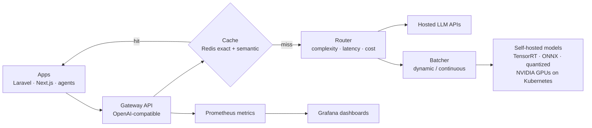

# LLM Inference Gateway

**LLM inference optimization platform.** Dynamic batching, quantization, intelligent model routing, caching and GPU scheduling to cut cost per request and tail latency.

> **Building in public.** The architecture and roadmap are published first. Code, benchmarks and results land milestone by milestone. Watch the repo to follow along.

## Problem

Generative AI adoption brings high GPU costs and unpredictable latency. Sending every request to the largest model wastes money; self-hosted models waste GPUs when requests aren't batched; and nobody knows the real cost per feature.

## Solution

An inference gateway that sits in front of hosted APIs and self-hosted models:

- **Intelligent routing.** A lightweight classifier scores request complexity and picks the cheapest model that meets the quality and latency target.
- **Semantic + exact caching** in Redis for repeated and near-duplicate prompts.
- **Dynamic batching** and continuous batching for self-hosted models.
- **Quantization** (INT8 / FP8 / 4-bit) and **TensorRT / ONNX** engines for model-specific optimization.
- **KV-cache optimization** and **GPU scheduling** across a Kubernetes GPU node pool.
- **Observability.** Prometheus metrics for latency, tokens, cost and GPU utilization per route, with Grafana dashboards.
- **OpenAI-compatible API**, so apps (including Laravel and Next.js) switch by changing a base URL.

## Architecture

## Tech stack

| Layer | Technologies |
| --- | --- |
| Models & optimization | PyTorch, CUDA, TensorRT, ONNX Runtime, quantization (INT8 / FP8 / 4-bit), KV-cache tuning |
| Serving | vLLM / TensorRT-LLM backends, dynamic batching, FastAPI gateway |
| Routing | Complexity classifier, cost / latency policies, fallbacks |
| Caching | Redis (exact + embedding-based semantic cache) |
| Infrastructure | Kubernetes, NVIDIA GPUs, GPU scheduling, Docker, Terraform |
| Observability | Prometheus, Grafana, per-route cost accounting |

## Targets and how they are measured

| Target | Metric | Method | Result |
| --- | --- | --- | --- |
| −61% p95 latency vs. naive serving | p95 latency | Same workload replayed before/after | pending |
| +38% GPU utilization | Avg. SM utilization | DCGM exporter in Prometheus | pending |
| −42% cost per request at equal quality | $ / 1K requests, eval score | Routed vs. single-large-model baseline | pending |

## Roadmap

- [x] Architecture and design document
- [ ] OpenAI-compatible gateway with hosted-API passthrough
- [ ] Exact + semantic cache in Redis
- [ ] Complexity router with cost / latency policies
- [ ] Self-hosted backend with dynamic batching
- [ ] Quantized and TensorRT / ONNX engines, benchmark matrix
- [ ] Kubernetes GPU deployment and scheduling
- [ ] Prometheus / Grafana dashboards and public benchmark report

---

Built by [Mohammed Al-Mekhlafi](https://github.com/m-makhlafi) · Full-Stack & AI Engineer
